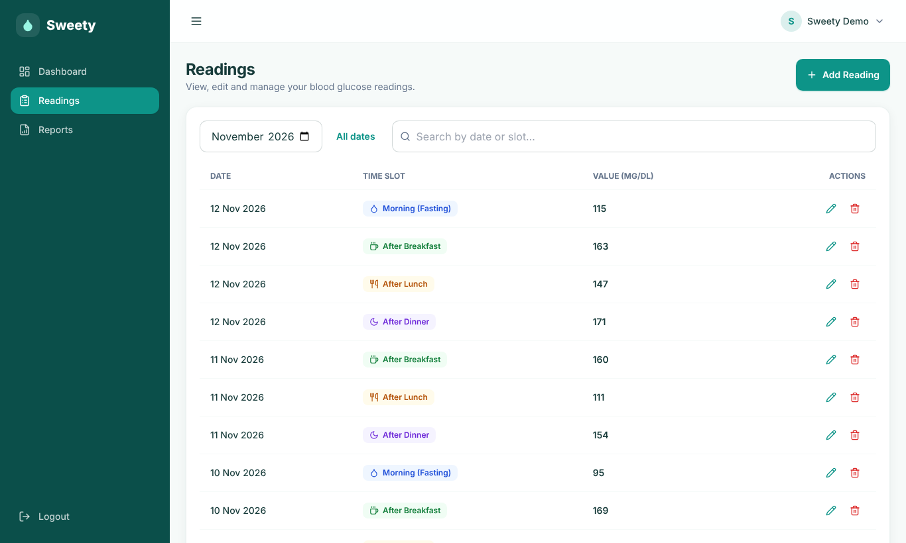
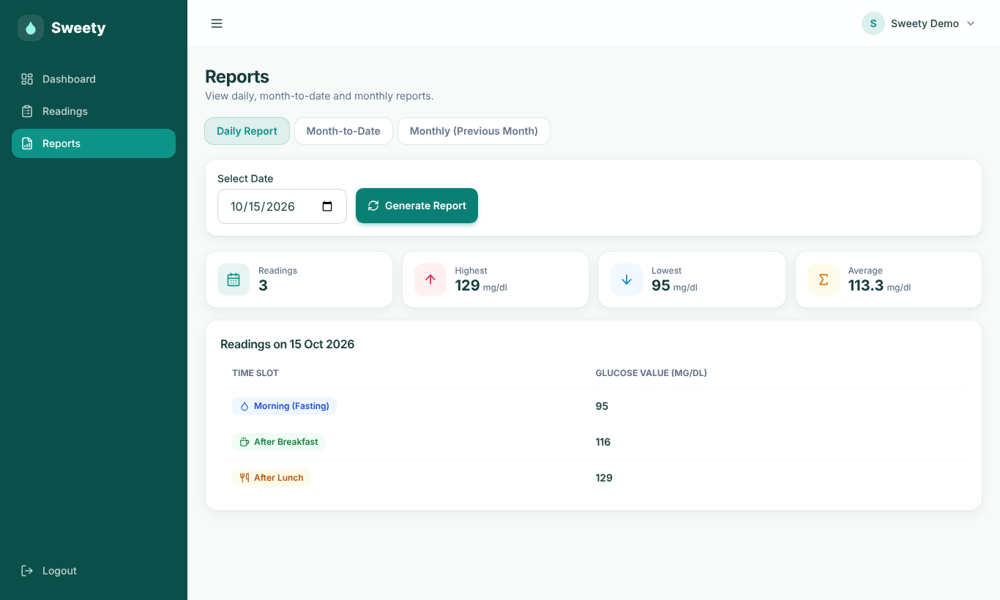
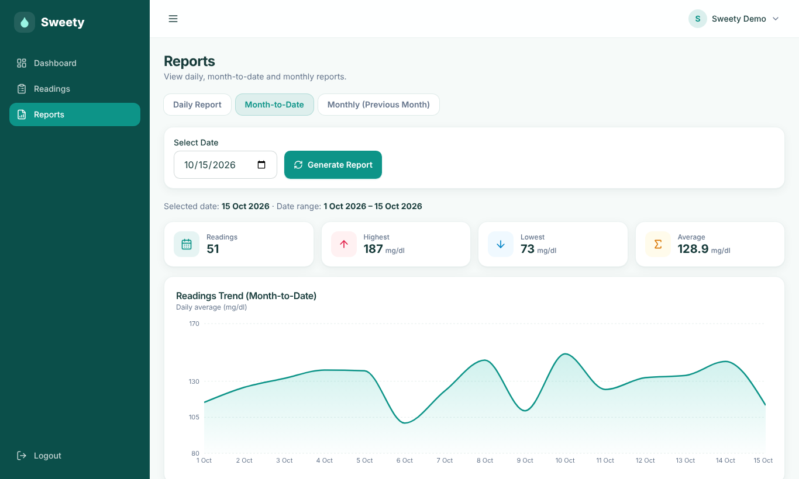
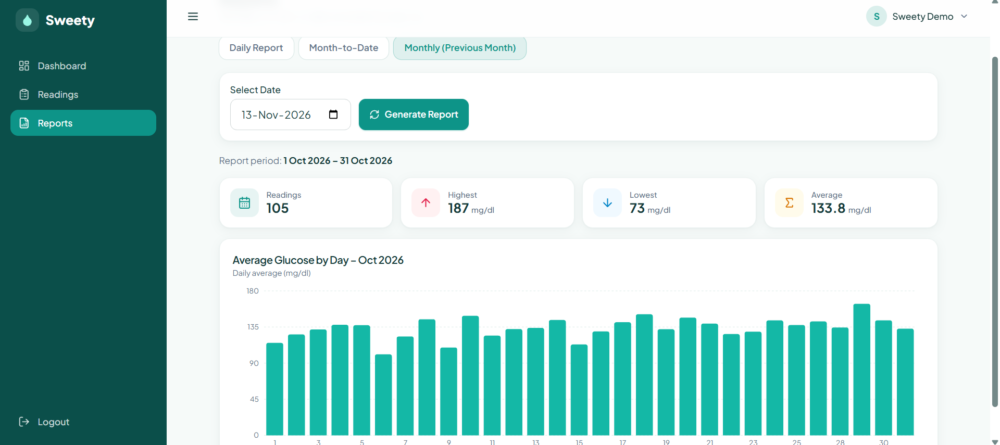
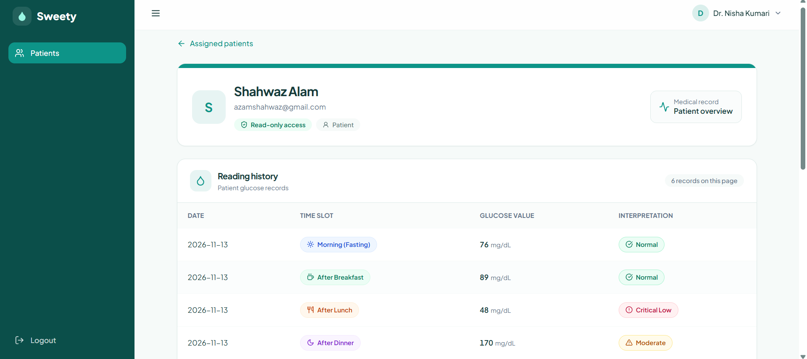
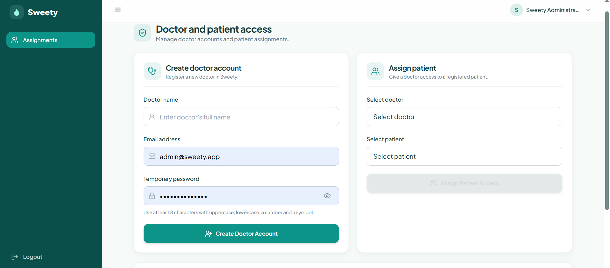

# Sweety — Blood Glucose Tracker

Sweety is a full-stack blood glucose tracking application. Patients can record up to four readings per day, review trends, and generate daily and monthly reports. The application also includes doctor and administrator workflows for assigned patient records and account management.

Sweety is a tracking and education tool. Glucose interpretations are general reference comparisons, not a diagnosis or personalized treatment advice.

---

## Table of Contents

- [Screenshots](#screenshots)
- [About the Project](#about-the-project)
- [Key Features](#key-features)
- [User Roles and Permissions](#user-roles-and-permissions)
- [Authentication and Security](#authentication-and-security)
- [Glucose Reading Management and Validation](#glucose-reading-management-and-validation)
- [Dashboard and Analytics](#dashboard-and-analytics)
- [Reports](#reports)
- [Redis Caching and BullMQ Background Jobs](#redis-caching-and-bullmq-background-jobs)
- [Application Architecture](#application-architecture)
- [Technology Stack](#technology-stack)
- [Database Design and Migrations](#database-design-and-migrations)
- [Project Structure](#project-structure)
- [Environment Variables](#environment-variables)
- [Prerequisites](#prerequisites)
- [Installation and Setup](#installation-and-setup)
- [Docker Compose](#docker-compose)
- [API Documentation](#api-documentation)
- [Available npm Scripts](#available-npm-scripts)
- [Testing](#testing)
- [Engineering Highlights](#engineering-highlights)
- [Notes and Assumptions](#notes-and-assumptions)
- [Known Limitations](#known-limitations)
- [Future Improvements](#future-improvements)
- [Medical Disclaimer](#medical-disclaimer)

---

## Screenshots

### 01. Login Page


Provides sign-in for existing patient, doctor, and administrator accounts.

---

### 02. Registration Page


Allows a new patient to register with a name, email, and password.

---

### 03. Patient Dashboard


Summarizes the patient's readings and displays recent entries and glucose trends.

---

### 04. Add Reading Modal


Records a glucose value, date, and one of the four daily reading slots.

---

### 05. Reading History



Shows the patient's saved readings with filtering and paginated results.

---

### 06. Edit Reading Modal


Edits a saved reading while applying the reading validation rules.

---

### 07. Daily Report



Displays the selected day's summary and individual readings.

---

### 08. Month-to-Date Report



Summarizes readings from the first day of the selected month through the selected date.

---

### 09. Previous-Month Report



Summarizes the complete calendar month before the selected date's month.

---

### 10. Doctor — Assigned Patient Reading History



Allows doctors to review assigned patients' glucose reading history, including dates, slots, glucose values, and interpretations.

---

### 11. Admin — Doctor and Patient Access Management



Provides administrator workflows to create doctor accounts and assign or unassign patients.

---

## About the Project

Sweety was built around the core assignment of personal glucose entry and reporting. Patient accounts can manage their own readings and view a dashboard and three report periods. The current implementation extends that core with role-based doctor access, administrator-managed assignments, per-tab sessions, Redis report caching, and a scheduled reminder-log worker.

## Key Features

### Required assignment features

- Patient registration and login with bcrypt password hashing.
- Patient-owned glucose reading create, view, update, and delete operations.
- Four reading slots: morning fasting, after breakfast, after lunch, and after dinner.
- Reading validation from 40 through 600 mg/dL, one reading per slot per day, a four-reading daily maximum, and rejection of future dates.
- Daily, month-to-date, and previous-calendar-month reports with highest, lowest, average, and total statistics.
- Daily report details and friendly empty states.

### Additional implemented features

- Patient dashboard with summary cards, trends, daily distribution, slot counts, and recent readings.
- Paginated reading history with date, month, and text filters.
- Slot-based educational interpretation and visual range indicator.
- Doctor role with assigned-patient list, reading history, and reports.
- Administrator tools to create doctor accounts and manage doctor-patient assignments.
- Redis-backed report cache with PostgreSQL fallback when Redis is unavailable.
- BullMQ worker that writes reminder audit logs for users with fewer than four readings at 8:00 PM Asia/Kolkata. It does not send email, SMS, push, or other notifications.
- Responsive layout, Docker Compose deployment, backend tests, and frontend tests.

---

## User Roles and Permissions

| Role | Capabilities |
|---|---|
| `PATIENT` | Manage own readings; view own dashboard and reports. |
| `DOCTOR` | View assigned patients, their readings, and their reports. |
| `ADMIN` | List accounts, create doctor accounts, and add or remove doctor-patient assignments. |

Public registration always creates a `PATIENT` account. Doctor accounts and assignments are managed by an administrator. The initial administrator is created through the controlled `create-admin` command.

---

## Authentication and Security

- Passwords are hashed with `bcryptjs`.
- Login issues a signed JWT tied to a server-side session row. The frontend stores the token in the current tab's `sessionStorage` and sends it in the `X-Tab-Session` request header.
- Each browser tab receives an independent session. Logging out revokes only that tab's session.
- Protected API routes check the session; doctor and administrator routes also enforce their roles. Reading, dashboard, and report routes operate on records owned by the authenticated account, while doctor routes are limited to assigned patients. The backend data routes authenticate sessions but do not separately require the `PATIENT` role.
- Helmet, credentialed CORS, parameterized SQL, request validation, and rate limiting on registration and login are used.
- State-changing requests with a supplied `Origin` are rejected if that origin is outside `FRONTEND_URL`. Requests without an `Origin` are permitted by this middleware.

---

## Glucose Reading Management and Validation

| Slot value | Display name | Interpretation type |
|---|---|---|
| `MORNING_FASTING` | Morning (Fasting) | Fasting reference ranges |
| `AFTER_BREAKFAST` | After Breakfast | General post-meal ranges |
| `AFTER_LUNCH` | After Lunch | General post-meal ranges |
| `AFTER_DINNER` | After Dinner | General post-meal ranges |

A reading must be a whole number from 40 to 600 mg/dL. A patient can save each slot once per date, for a maximum of four readings on that date. The date cannot be in the future, as determined by `APP_TIMEZONE` (default `Asia/Kolkata`). Database constraints reinforce the value range, allowed slots, and per-slot uniqueness; a transaction and per-user row lock enforce the daily limit during concurrent writes.

Interpretation uses fasting ranges for the morning fasting slot and general post-meal ranges for the other slots. Selecting a slot does not verify fasting duration or time since a meal. Interpretations are educational only; see the disclaimer shown in the application.

---

## Dashboard and Analytics

The patient dashboard provides today's reading count, selected-month statistics, five recent readings, daily averages and ranges, readings per day, and counts by slot.

---

## Reports

| Report | Date range |
|---|---|
| Daily | The selected date |
| Month-to-date | First day of the selected date's month through the selected date, inclusive |
| Previous month | The full calendar month before the selected date's month |

Reports include the highest, lowest, average (rounded to one decimal place), and total readings. Daily reports also include individual readings and slot labels. Empty ranges return a total of zero and null highest, lowest, and average values, with an empty-state indicator.

---

## Redis Caching and BullMQ Background Jobs

The BullMQ scheduler runs daily at 8:00 PM Asia/Kolkata. The worker counts readings for that date and inserts a `reminder_logs` record for each user with fewer than four readings. A unique user/date constraint and conflict-safe insert prevent duplicate records. Failed jobs are retried with exponential backoff. These rows are audit logs only; no notification is delivered.

Redis caches patient report responses for `REPORT_CACHE_TTL_SECONDS` (300 seconds by default). Reading writes bump a per-user cache version. Redis is an optimization: the API falls back to PostgreSQL when the cache is unavailable. The worker requires Redis; report reads and writes remain available without it.

---

## Application Architecture

The backend follows a request pipeline of Express routes, request validation, authentication and role middleware, controllers, services, and PostgreSQL queries. A shared error handler formats API errors. Redis is used for report caching and BullMQ scheduling; the reminder worker runs as a separate process.

The React frontend uses Axios for API calls, React Router for navigation, and a tab-specific session token. In local development, Vite proxies `/api` requests to the backend.

---

## Technology Stack

| Area | Technologies |
|---|---|
| Frontend | React 18, Vite 5, React Router, Axios, Tailwind CSS, DaisyUI, Recharts, Lucide, React Hot Toast |
| Backend | Node.js, Express 4, `pg`, Zod, bcryptjs, jsonwebtoken, Helmet, CORS, express-rate-limit |
| Data and jobs | PostgreSQL, Redis, BullMQ, ioredis |
| Tests | Jest, Supertest, Vitest, React Testing Library |
| Local deployment | Docker Compose |

---

## Database Design and Migrations

The schema is created by the ordered SQL migrations in `backend/migrations/`. `database/schema.sql` is the checked-in reference schema for the core users and glucose readings tables; migrations are the source used to update a working database.

| Table | Purpose |
|---|---|
| `users` | Patient, doctor, and administrator accounts; role and report-cache version. |
| `glucose_readings` | Dated glucose readings, slot, value, and optional timing context. |
| `reminder_logs` | One reminder audit record per user and date. |
| `doctor_patient_assignments` | Doctor-to-patient access assignments. |
| `tab_sessions` | Expiring and revocable per-tab authentication sessions. |
| `schema_migrations` | Tracks successfully applied migration files. |

Migrations add the core schema, reminder logs, optional glucose timing fields, roles and assignments, and tab sessions. They are applied in filename order and recorded in `schema_migrations`.

---

## Project Structure

```text
sweety/
├── backend/
│   ├── migrations/          # Ordered SQL migrations and migration runner
│   ├── seeds/               # Demo data and controlled admin bootstrap
│   └── src/
│       ├── config/          # Database and environment configuration
│       ├── controllers/     # HTTP handlers
│       ├── middleware/      # Auth, validation, CSRF, and errors
│       ├── routes/          # API route definitions
│       ├── services/        # Business logic, reports, cache, reminders
│       ├── tests/           # Jest and Supertest tests
│       └── workers/         # BullMQ reminder worker
├── database/schema.sql      # Reference core schema
├── frontend/
│   └── src/
│       ├── api/             # Axios client and API functions
│       ├── components/      # Shared, dashboard, reading, and report UI
│       ├── context/         # Authentication state
│       ├── pages/           # Patient, doctor, admin, and auth pages
│       ├── tests/           # Vitest and Testing Library tests
│       └── utils/           # Date and validation helpers
├── screenshots/             # Screenshots documented above
├── .env.example             # Docker Compose environment template
└── docker-compose.yml
```

---

## Environment Variables

Copy the example files and set local values. Do not commit populated environment files.

| File | Variables |
|---|---|
| Root `.env` for Docker Compose | `POSTGRES_DB`, `POSTGRES_USER`, `POSTGRES_PASSWORD`, `JWT_SECRET`; optionally `NODE_ENV`, `JWT_EXPIRES_IN`, `FRONTEND_URL`, `COOKIE_SECURE`, `REDIS_PASSWORD`, `FRONTEND_PORT`. |
| `backend/.env` | `DATABASE_URL`, `JWT_SECRET`; optionally `PORT`, `NODE_ENV`, `JWT_EXPIRES_IN`, `FRONTEND_URL`, `COOKIE_SECURE`, `APP_TIMEZONE`, `BCRYPT_ROUNDS`, `AUTH_RATE_LIMIT_MAX`, `REDIS_HOST`, `REDIS_PORT`, `REDIS_PASSWORD`, `REPORT_CACHE_TTL_SECONDS`, `BOOTSTRAP_ADMIN_EMAIL`, `BOOTSTRAP_ADMIN_PASSWORD`. |
| `backend/.env.test` | `TEST_DATABASE_URL` (database name must end in `_test`), `JWT_SECRET`; optionally `JWT_EXPIRES_IN`, `FRONTEND_URL`, `COOKIE_SECURE`, `APP_TIMEZONE`, `BCRYPT_ROUNDS`. |
| `frontend/.env` | `VITE_API_URL`, normally `http://localhost:5000/api` for local development. |

`FRONTEND_URL` can contain comma-separated allowed frontend origins. `COOKIE_SECURE` is retained as a configuration option, but the current tab-session authentication sends its JWT in a request header rather than an authentication cookie. `APP_TIMEZONE` defaults to `Asia/Kolkata` for future-date validation. The reminder schedule and reminder date use `Asia/Kolkata` directly.

---

## Prerequisites

- Node.js and npm compatible with the installed Vite 5 toolchain (Node.js 18 or later is recommended).
- PostgreSQL with support for `gen_random_uuid()`.
- Redis for the report cache and reminder worker. The API can serve reports without Redis.

---

## Installation and Setup

### 1. Create databases

Create a development database and a separate test database. Test database names must end in `_test`.

```sql
CREATE DATABASE sweety_db;
CREATE DATABASE sweety_test;
```

### 2. Configure environment files

From the repository root, copy the templates:

```bash
cp .env.example .env
cp backend/.env.example backend/.env
cp backend/.env.test.example backend/.env.test
cp frontend/.env.example frontend/.env
```

Set a local PostgreSQL URL and a long random `JWT_SECRET` in `backend/.env`. Set `TEST_DATABASE_URL` in `backend/.env.test` to the separate test database. Set the root `.env` values required by Docker Compose if you plan to use Compose.

### 3. Install dependencies and migrate

```bash
cd backend
npm install
npm run migrate
```

The migration command applies outstanding migrations to the database configured by `DATABASE_URL`.

### 4. Seed demo records (optional)

```bash
npm run seed
```

The seed command runs migrations and idempotently creates development demo patient/doctor records, an assignment, and sample patient readings. It is for local evaluation only; its demo credentials are defined in `backend/seeds/seed.js` and must not be treated as production credentials.

### 5. Start the backend and frontend

Run each process in a separate terminal:

```bash
# Terminal 1
cd backend
npm run dev
```

```bash
# Terminal 2
cd frontend
npm install
npm run dev
```

The API listens on `http://localhost:5000` by default, and Vite serves the frontend at `http://localhost:5177`.

### 6. Start Redis and the reminder worker (optional)

Start a local Redis server, set `REDIS_HOST`, `REDIS_PORT`, and, if needed, `REDIS_PASSWORD` in `backend/.env`, then run:

```bash
cd backend
npm run worker
```

Run the worker in its own terminal. PostgreSQL migrations must be applied before starting it.

### Create an administrator (optional)

Set `BOOTSTRAP_ADMIN_EMAIL` and a unique, strong `BOOTSTRAP_ADMIN_PASSWORD` in `backend/.env`, then run:

```bash
cd backend
npm run create-admin
```

The bootstrap command requires a password of at least 12 characters containing uppercase and lowercase letters, a number, and a special character. Keep the values private and remove them from local configuration when finished.

---

## Docker Compose

Docker Compose starts PostgreSQL, Redis, the API, the reminder worker, and the built frontend. Create the root environment file and set at least `POSTGRES_PASSWORD` and a strong `JWT_SECRET`, then run:

```bash
docker compose up --build -d
docker compose ps
docker compose logs -f backend worker
```

The frontend is published on port `5177` by default (`FRONTEND_PORT` can change the host port). The backend container applies migrations before starting. PostgreSQL and Redis data are kept in named volumes. Seed demo data, if desired, with:

```bash
docker compose exec backend npm run seed
```

Stop the services with `docker compose down`. This keeps the named data volumes; removing volumes would delete local database data.

---

## API Documentation

All endpoints are prefixed with `/api`. Except for health and authentication routes noted below, requests require the `X-Tab-Session` header returned by login. JSON responses use a `success`, `message`, and `data` envelope; errors may include field-level `errors`.

### Health and authentication

| Method | Endpoint | Purpose | Authentication |
|---|---|---|---|
| `GET` | `/health` | API health check. | No |
| `POST` | `/auth/register` | Register a patient with name, email, password, and confirmation. | No |
| `POST` | `/auth/login` | Start a session; returns the user and tab session token. | No |
| `POST` | `/auth/logout` | Revoke the current tab's session. | Yes |
| `GET` | `/auth/me` | Return the current user. | Yes |

### Reading management

| Method | Endpoint | Purpose | Authentication |
|---|---|---|---|
| `POST` | `/readings` | Create a reading (`reading_date`, `time_slot`, `glucose_value`). | Authenticated |
| `GET` | `/readings` | List readings owned by the authenticated account. Optional query: `date`, `month`, `search`, `page`, `limit`. | Authenticated |
| `GET` | `/readings/:id` | Get one own reading. | Authenticated |
| `PUT` | `/readings/:id` | Update one own reading. | Authenticated |
| `DELETE` | `/readings/:id` | Delete one own reading. | Authenticated |
| `POST` | `/readings/interpretation` | Preview interpretation from `glucose_value` and `time_slot`. | Authenticated |

### Dashboard and reports

| Method | Endpoint | Purpose | Authentication |
|---|---|---|---|
| `GET` | `/dashboard/summary?date=YYYY-MM-DD&month=YYYY-MM` | Today's count, selected-month statistics, and five recent readings. | Authenticated |
| `GET` | `/dashboard/trends?month=YYYY-MM` | Daily trend, per-day counts, slot counts, and total. | Authenticated |
| `GET` | `/reports/daily?date=YYYY-MM-DD` | Selected-day summary and readings. | Authenticated |
| `GET` | `/reports/month-to-date?date=YYYY-MM-DD` | Month-to-date summary. | Authenticated |
| `GET` | `/reports/monthly?date=YYYY-MM-DD` | Previous full calendar month summary. | Authenticated |

### Doctor

A doctor can only access patients assigned to that doctor.

| Method | Endpoint | Purpose | Authentication |
|---|---|---|---|
| `GET` | `/doctor/patients?page=1&limit=20&search=` | List assigned patients. | Doctor |
| `GET` | `/doctor/patients/:patientId/readings?page=1&limit=20` | List an assigned patient's readings. | Doctor |
| `GET` | `/doctor/patients/:patientId/reports/daily?date=YYYY-MM-DD` | Assigned patient's daily report. | Doctor |
| `GET` | `/doctor/patients/:patientId/reports/month-to-date?date=YYYY-MM-DD` | Assigned patient's month-to-date report. | Doctor |
| `GET` | `/doctor/patients/:patientId/reports/monthly?date=YYYY-MM-DD` | Assigned patient's previous-month report. | Doctor |

### Administrator

| Method | Endpoint | Purpose | Authentication |
|---|---|---|---|
| `GET` | `/admin/accounts` | List doctors, patients, and assignments. | Admin |
| `POST` | `/admin/doctors` | Create a doctor account (`name`, `email`, `password`). | Admin |
| `POST` | `/admin/assignments` | Assign a patient to a doctor (`doctorId`, `patientId`). | Admin |
| `DELETE` | `/admin/assignments/:assignmentId` | Remove an assignment. | Admin |

Typical status codes include `200` for success, `201` for creation, `400` for invalid input, `401` for unauthenticated requests, `403` for forbidden requests or disallowed origins, `404` for missing or inaccessible records, and `409` for conflicts such as duplicate readings.

---

## Available npm Scripts

| Package | Command | Description |
|---|---|---|
| Backend | `npm start` | Start the API server. |
| Backend | `npm run dev` | Start the API with Node watch mode. |
| Backend | `npm run migrate` | Apply migrations to the configured database. |
| Backend | `npm run migrate:test` | Apply migrations using test environment configuration. |
| Backend | `npm run seed` | Apply migrations and insert demo records. |
| Backend | `npm run create-admin` | Create or promote the configured bootstrap administrator. |
| Backend | `npm run worker` | Start the BullMQ reminder worker and scheduler. |
| Backend | `npm test` | Run Jest/Supertest backend tests serially. |
| Backend | `npm run test:coverage` | Run backend tests with coverage. |
| Frontend | `npm run dev` | Start the Vite development server. |
| Frontend | `npm run build` | Build the production frontend. |
| Frontend | `npm run preview` | Preview the production build locally. |
| Frontend | `npm test` | Run Vitest tests. |
| Frontend | `npm run test:coverage` | Run frontend tests with coverage. |

---

## Testing

Configure `backend/.env.test` with `TEST_DATABASE_URL` pointing to a separate database whose name ends in `_test`. The backend explicitly refuses a test database URL without that suffix. Run the tests from each package directory:

```bash
cd backend
npm run migrate:test
npm test
npm run test:coverage
```

```bash
cd frontend
npm test
npm run test:coverage
npm run build
```

Backend tests use PostgreSQL. The reminder and Redis cache tests exercise their service logic with test doubles; a live Redis instance is not required for the backend test suite.

---

## Engineering Highlights

- Database constraints and transactional locking protect reading slots and daily limits.
- Role checks and assignment checks protect doctor and administrator workflows.
- Per-tab sessions can be revoked independently at logout.
- Report cache keys include a per-user version that changes after reading writes.
- Ordered migrations are recorded in `schema_migrations` and can be safely rerun.
- Backend and frontend packages have separate automated test suites.

---

## Notes and Assumptions

- Public sign-up always creates a patient account. Admin setup is a deliberate command-line bootstrap; there is no public role selection.
- Future-date validation uses `APP_TIMEZONE` (default `Asia/Kolkata`). Reminder scheduling and reminder dates use the Asia/Kolkata timezone.
- Dashboard date and month parameters determine the displayed date and month summaries. The recent readings list is based on the patient's latest readings.
- Reading slots select a general fasting or post-meal reference comparison. They do not confirm fasting duration or a specific interval after eating.
- The seed script creates local demo patient and doctor records. Its credentials are defined in `backend/seeds/seed.js` and are for development only.

---

## Known Limitations

- The reminder worker creates audit records only; it does not deliver notifications.
- Redis cache outages fall back to PostgreSQL report calculations, but the BullMQ worker requires Redis.
- The repository does not document a license, author attribution, or deployed demo URL.
- Most data API routes authenticate a session and scope data to that account, but do not separately enforce the `PATIENT` role. Doctor routes and administrator routes have role checks.

---

## Future Improvements

- Add email, SMS, or push notification delivery if reminder delivery becomes a requirement.
- Add password recovery and data export.
- Expand end-to-end browser coverage and frontend tests for reports and charts.

---

## Medical Disclaimer

Glucose categories are general educational reference ranges and are not a medical diagnosis. Individual targets vary, and a single reading cannot diagnose diabetes or prediabetes. Consult a qualified healthcare professional for personal guidance and follow their advice for medication, insulin, and abnormal readings.
