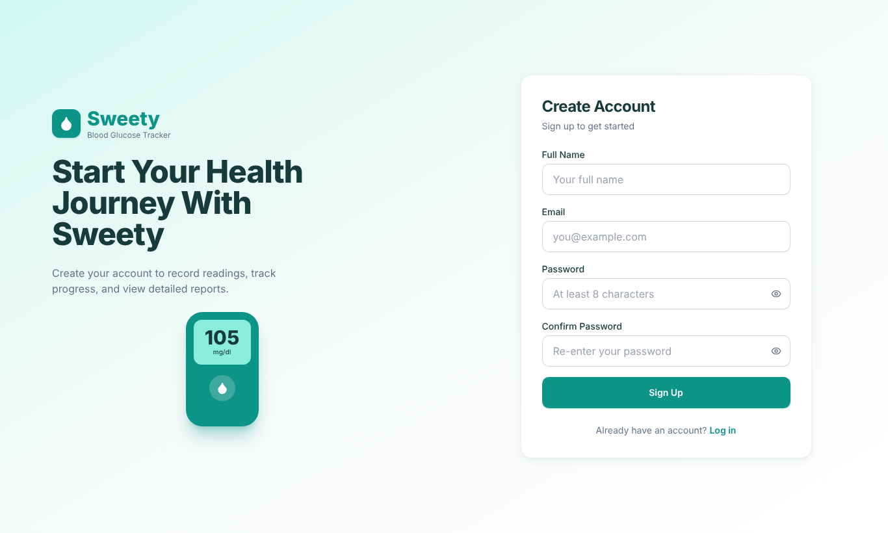
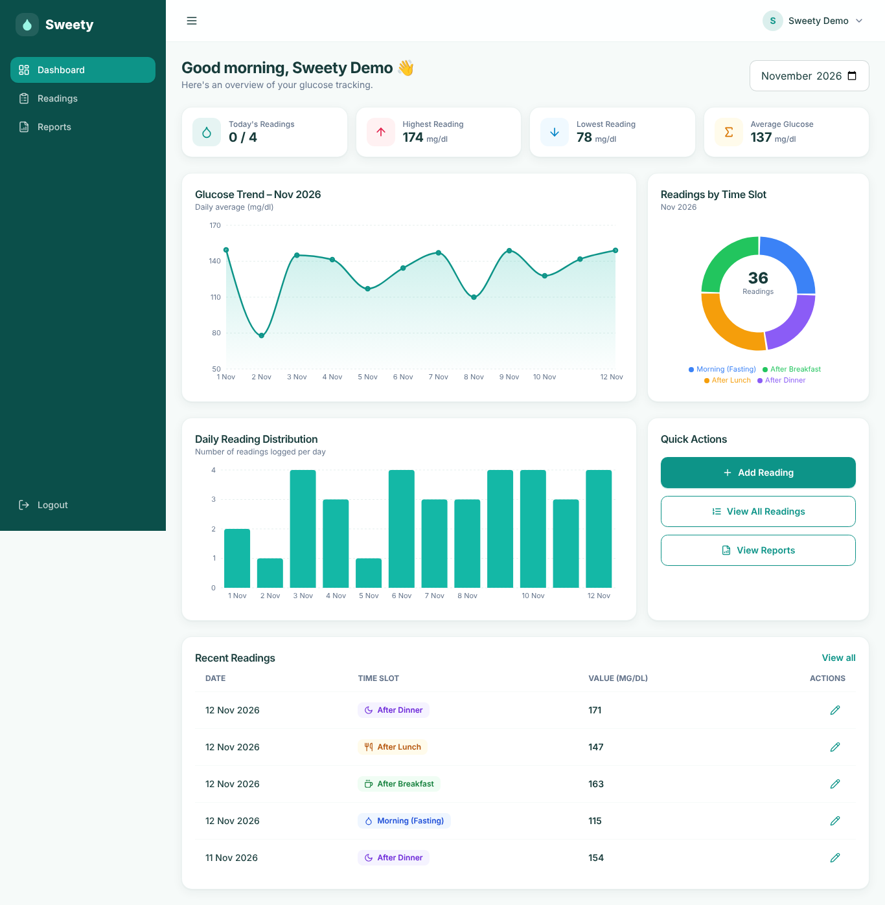
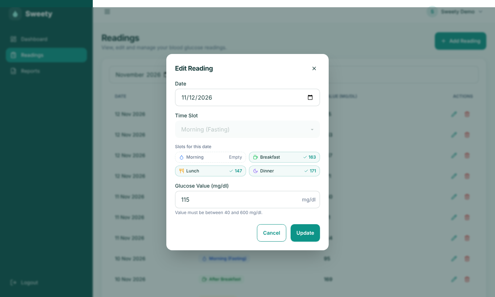
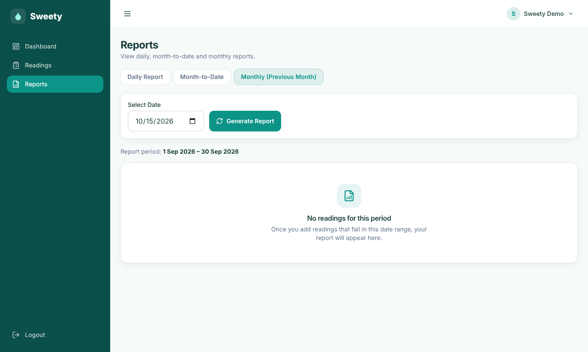

# Sweety – Blood Glucose Tracker

A full-stack web app to log blood glucose readings (up to 4 per day), view them in a clean dashboard, and generate daily, month-to-date and previous-month reports.
Sweety is a **tracking tool only** – it gives no diagnosis, treatment advice or "safe/dangerous" labels.

## Features
- Register / login with JWT stored in an **HTTP-only cookie**; logout clears it
- Add, view, edit, delete readings (date, time slot, value in mg/dl) with ownership checks on every query
- Validation on frontend **and** backend + PostgreSQL constraints
- Max 4 readings/day enforced in a DB transaction with a per-user row lock (plus `UNIQUE(user_id, reading_date, time_slot)`)
- Reports (computed in PostgreSQL): Daily, Month-to-Date, Previous Month – highest / lowest / average (1 decimal) / total
- Dashboard: summary cards, glucose trend, readings by time slot, daily reading distribution, recent readings, quick actions
- Responsive UI (sidebar + mobile drawer), loading / error / empty states, toasts, Tailwind + DaisyUI theme **sweety-health**

## Tech stack
React 18, Vite, Tailwind CSS 3, DaisyUI 4, React Router, Axios, Recharts, Lucide, React Hot Toast ·
Node.js, Express, PostgreSQL (`pg`), jsonwebtoken, bcryptjs, Zod, helmet, cors, express-rate-limit ·
Jest + Supertest (backend), Vitest + React Testing Library (frontend)

## Screenshots
| | | |
|---|---|---|
|  |  |  |
|  |  |  |
|  |  |  |

Also: `06b-delete-confirm.png`, `10-mobile-dashboard.png`, `11-mobile-drawer.png`, `12-not-found.png`.

## Project structure
```
sweety/
├── backend/   src/{config,controllers,middleware,routes,services,validators,utils,tests}, migrations/, seeds/
├── frontend/  src/{api,components,context,hooks,pages,routes,utils,tests}
├── database/schema.sql      (reference copy of migrations/001_init.sql)
└── screenshots/
```
Flow: `routes → validate → controller → service → PostgreSQL`; errors go to one central handler.

## Database schema
```sql
users(id UUID PK, name VARCHAR(100), email VARCHAR(255) UNIQUE, password_hash TEXT, created_at, updated_at)
glucose_readings(id UUID PK, user_id UUID FK→users ON DELETE CASCADE, reading_date DATE, time_slot VARCHAR(30),
  glucose_value INTEGER CHECK 40..600, created_at, updated_at,
  CHECK time_slot IN (MORNING_FASTING, AFTER_BREAKFAST, AFTER_LUNCH, AFTER_DINNER),
  UNIQUE(user_id, reading_date, time_slot))
-- indexes: user_id, reading_date, (user_id, reading_date); triggers keep updated_at current
```
Because only 4 slots exist and each may appear once per day, the database itself can never hold more than 4 readings per user per day.

## Prerequisites
Node.js 18+ and PostgreSQL 14+ (needs `gen_random_uuid()`).

## PostgreSQL setup
```sql
CREATE DATABASE sweety_db;     -- development
CREATE DATABASE sweety_test;   -- automated tests only (name MUST end with _test)
```

## Environment setup
```bash
cp backend/.env.example backend/.env             # edit DATABASE_URL and JWT_SECRET
cp backend/.env.test.example backend/.env.test   # test DB settings
cp frontend/.env.example frontend/.env
```
Backend `.env` keys: `PORT, NODE_ENV, DATABASE_URL, JWT_SECRET, JWT_EXPIRES_IN, FRONTEND_URL, COOKIE_SECURE` plus optional `APP_TIMEZONE` (default `Asia/Kolkata`, used to decide what "today" is for the future-date rule) and `BCRYPT_ROUNDS` (default 12). Frontend: `VITE_API_URL`.
Never commit real `.env` files (they are git-ignored).

## Install, migrate, seed, run
```bash
# backend
cd backend && npm install
npm run migrate      # creates tables (safe to re-run)
npm run seed         # demo user + sample readings (safe to re-run)
npm run dev          # http://localhost:5000

# frontend (new terminal)
cd frontend && npm install
npm run dev          # http://localhost:5173
```

## Demo credentials
| Email | Password |
|---|---|
| `demo@sweety.app` | `SweetyDemo@123` |

The seed script only touches this demo account: readings from the 1st of last month up to today, all four slots on every third day, idempotent via `ON CONFLICT DO NOTHING`.

## API
All responses: `{ "success": true|false, "message": "...", "data": {...} }` (errors may add `"errors": {field: message}`).
Protected endpoints need the `sweety_token` cookie set by login. Status codes: 200/201 ok · 400 validation · 401 unauthenticated · 403 bad origin · 404 not found (also for other users' data) · 409 duplicate slot / daily limit.

| Method & path | Purpose |
|---|---|
| `POST /api/auth/register` | `{name,email,password,confirmPassword}` → 201 `{user}` |
| `POST /api/auth/login` | `{email,password}` → sets cookie, `{user}` |
| `POST /api/auth/logout` | clears cookie |
| `GET /api/auth/me` | current user |
| `POST /api/readings` | `{reading_date,time_slot,glucose_value}` |
| `GET /api/readings` | query: `month=YYYY-MM`, `date=YYYY-MM-DD`, `search`, `page`, `limit` (newest first) |
| `GET/PUT/DELETE /api/readings/:id` | own readings only |
| `GET /api/reports/daily?date=` | selected day |
| `GET /api/reports/month-to-date?date=` | 1st of month → date (inclusive) |
| `GET /api/reports/monthly?date=` | whole previous calendar month |
| `GET /api/dashboard/summary?date=&month=` | today's count, month stats, 5 recent readings |
| `GET /api/dashboard/trends?month=YYYY-MM` | daily averages, per-day counts, per-slot counts |

```bash
# login (Origin header is required in browsers anyway; shown for completeness)
curl -c jar.txt -H "Content-Type: application/json" -H "Origin: http://localhost:5173" \
  -d '{"email":"demo@sweety.app","password":"SweetyDemo@123"}' http://localhost:5000/api/auth/login

# add a reading
curl -b jar.txt -H "Content-Type: application/json" -H "Origin: http://localhost:5173" \
  -d '{"reading_date":"2026-10-15","time_slot":"AFTER_LUNCH","glucose_value":128}' http://localhost:5000/api/readings
```
```json
{ "success": true, "message": "Reading added successfully",
  "data": { "reading": { "id": "…", "reading_date": "2026-10-15", "time_slot": "AFTER_LUNCH", "glucose_value": 128 } } }
{ "success": false, "message": "You can add only 4 readings per day." }
```
Report response (`/api/reports/daily?date=2026-10-15`): `data = { range:{from,to}, stats:{total,highest,lowest,average}, readings:[…], isEmpty }`. Empty ranges return `total: 0` and `null` for the other stats.

## Security notes
bcrypt hashing · user identity only from the verified JWT · parameterized SQL · helmet · rate limiting on login/register (default 20 per 15 min, `AUTH_RATE_LIMIT_MAX`) · credentialed CORS limited to `FRONTEND_URL` · cookie `HttpOnly`, `Secure` + `SameSite=None` when `COOKIE_SECURE=true`, otherwise `Lax` · **CSRF**: state-changing requests carrying a non-allowed `Origin` are rejected (browsers always send `Origin` on such requests).

## Tests
```bash
cd backend  && npm test            # 54 tests
cd backend  && npm run test:coverage
cd frontend && npm test            # 35 tests
cd frontend && npm run test:coverage
```
**Test-database safety:** backend tests load `.env.test` only, read `TEST_DATABASE_URL`, and the app refuses to start under `NODE_ENV=test` unless the database name ends with `_test` and differs from `DATABASE_URL`. Cleanup truncates only the two app tables after re-checking `current_database()`. Tests run serially (`--runInBand`) on that one database.

Latest results (run in the build environment, PostgreSQL 16):
- Backend: 3 suites, **54 passed**; coverage 96.5% statements / 78.2% branches / 98.1% lines
- Frontend: 3 files, **35 passed**; coverage 61.8% statements overall – auth, reading form, readings table/page, validation and date utils are well covered; Dashboard, Reports, chart and layout components are not unit-tested (they were checked end-to-end in a real browser, see Notes)

## Assumptions
- "Today" for the future-date rule uses `APP_TIMEZONE` (default Asia/Kolkata); the frontend uses the browser's local date.
- Register does not auto-login; the user is sent to the login page.
- Dashboard cards and charts show the selected month (current month by default); "Today's Readings" is always today.
- "Daily Reading Distribution" = number of readings logged per day.
- In the edit form the time slot is locked (as in the mockup); the date and value can change, and the backend re-checks duplicates and the daily limit.
- Reports/dashboard only count readings of the logged-in user.

## Known limitations
- No password reset, "remember me", profile page or notifications (not part of the required scope).
- No Docker setup (optional bonus, not implemented).
- Frontend unit tests do not cover the Dashboard/Reports pages or chart components.
- JWT is not revocable server-side; logout only clears the cookie.
- Google Fonts are loaded from a CDN (falls back to system fonts offline).

## Future improvements
Docker Compose, refresh tokens/revocation, CSV/PDF export, Playwright E2E tests, more frontend tests for charts/reports, code-splitting the bundle, i18n.
