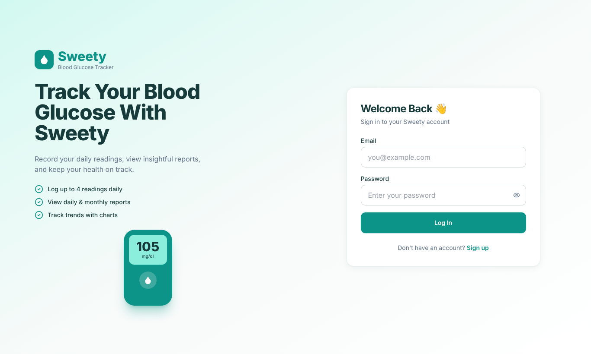
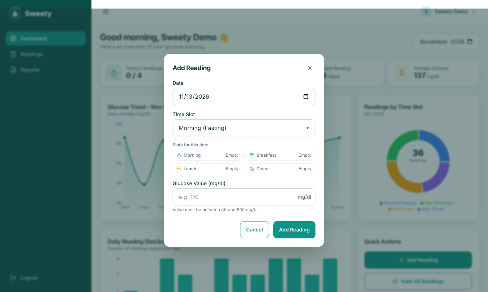

# Sweety – Blood Glucose Tracker

A full-stack web app to log blood glucose readings (up to 4 per day), view them in a clean dashboard, and generate daily, month-to-date and previous-month reports.
Sweety is a **tracking tool only**. Its glucose reference interpretations are general indicators, not diagnoses or personalized treatment guidance.

## Features
- Register / login with JWT stored in an **HTTP-only cookie**; logout clears it
- Add, view, edit, delete readings (date, time slot, value in mg/dl) with ownership checks on every query
- Validation on frontend **and** backend + PostgreSQL constraints
- Max 4 readings/day enforced in a DB transaction with a per-user row lock (plus `UNIQUE(user_id, reading_date, time_slot)`)
- Reports (computed in PostgreSQL): Daily, Month-to-Date, Previous Month – highest / lowest / average (1 decimal) / total
- Dashboard: summary cards, glucose trend, readings by time slot, daily reading distribution, recent readings, quick actions
- Slot-based reference interpretation in add/edit, reading history, dashboard recent readings and daily reports. Existing timing columns remain compatible but do not gate general comparisons or imply verified meal duration.
- Responsive UI (sidebar + mobile drawer), loading / error / empty states, toasts, Tailwind + DaisyUI theme **sweety-health**

## Tech stack
React 18, Vite, Tailwind CSS 3, DaisyUI 4, React Router, Axios, Recharts, Lucide, React Hot Toast ·
Node.js, Express, PostgreSQL (`pg`), jsonwebtoken, bcryptjs, Zod, helmet, cors, express-rate-limit ·
Jest + Supertest (backend), Vitest + React Testing Library (frontend)

## Screenshots
| | | |
|---|---|---|
|  |  |  |
|  |  |  |
|  |  |  |

Also: `06b-delete-confirm.png`, `10-mobile-dashboard.png`, `11-mobile-drawer.png`, `12-not-found.png`.

## Project structure
```
sweety/
├── backend/   src/{config,controllers,middleware,routes,services,validators,utils,tests}, migrations/, seeds/
├── frontend/  src/{api,components,context,hooks,pages,routes,utils,tests}
├── database/schema.sql      (reference copy of migrations/001_init.sql)
└── screenshots/
```
Flow: `routes → validate → controller → service → PostgreSQL`; errors go to one central handler.

## Database schema
```sql
users(id UUID PK, name VARCHAR(100), email VARCHAR(255) UNIQUE, password_hash TEXT, created_at, updated_at)
glucose_readings(id UUID PK, user_id UUID FK→users ON DELETE CASCADE, reading_date DATE, time_slot VARCHAR(30),
  glucose_value INTEGER CHECK 40..600, created_at, updated_at,
  fasting_confirmed BOOLEAN NULL, meal_timing_minutes INTEGER NULL,
  CHECK time_slot IN (MORNING_FASTING, AFTER_BREAKFAST, AFTER_LUNCH, AFTER_DINNER),
  UNIQUE(user_id, reading_date, time_slot))
-- indexes: user_id, reading_date, (user_id, reading_date); triggers keep updated_at current
```
Because only 4 slots exist and each may appear once per day, the database itself can never hold more than 4 readings per user per day.

## Prerequisites
Node.js 18+ and PostgreSQL 14+ (needs `gen_random_uuid()`). Docker Compose is available as an alternative and starts PostgreSQL, Redis, backend, reminder worker and frontend.

## PostgreSQL setup
```sql
CREATE DATABASE sweety_db;     -- development
CREATE DATABASE sweety_test;   -- automated tests only (name MUST end with _test)
```

## Environment setup
```bash
cp backend/.env.example backend/.env             # edit DATABASE_URL and JWT_SECRET
cp backend/.env.test.example backend/.env.test   # test DB settings
cp frontend/.env.example frontend/.env
```
Backend `.env` keys: `PORT, NODE_ENV, DATABASE_URL, JWT_SECRET, JWT_EXPIRES_IN, FRONTEND_URL, COOKIE_SECURE` plus optional `APP_TIMEZONE` (default `Asia/Kolkata`, used to decide what "today" is for the future-date rule) and `BCRYPT_ROUNDS` (default 12). Frontend: `VITE_API_URL`.
Never commit real `.env` files (they are git-ignored).

Docker Compose reads the root `.env`; the backend loads `backend/.env` for local runs and `backend/.env.test` only under `NODE_ENV=test`. Frontend Vite reads `frontend/.env`. Test database names must end in `_test` and must be separate from development databases. The checked-in examples use placeholders; configure local credentials privately before starting services.

## Install, migrate, seed, run
```bash
# backend
cd backend && npm install
npm run migrate      # creates tables (safe to re-run)
npm run seed         # demo user + sample readings (safe to re-run)
npm run dev          # http://localhost:5000

# frontend (new terminal)
cd frontend && npm install
npm run dev          # http://localhost:5177
```

## Redis and BullMQ reminders
The backend worker uses BullMQ and Redis to schedule one job each day at **8:00 PM Asia/Kolkata**. Each run counts readings for the current IST calendar date and inserts a `reminder_logs` row for each user with fewer than four readings. The `(user_id, reminder_date)` database constraint and `ON CONFLICT DO NOTHING` make repeated jobs safe. Jobs retry up to five times with exponential backoff. This feature only writes database logs; it does not send notifications.

For a local non-Docker run, start Redis, set `REDIS_HOST`, `REDIS_PORT` and optionally `REDIS_PASSWORD` in `backend/.env`, then run `npm run worker` from `backend` in its own terminal alongside the API. Run `npm run migrate` before starting either process.

## Docker Compose
Copy `.env.example` to `.env` in the repository root and replace the PostgreSQL password and JWT secret. Then:

```bash
docker compose up --build -d       # start all services
docker compose ps                  # inspect health
docker compose logs -f backend worker
docker compose down                # stop services; persistent data is retained
```

The backend container applies migrations before starting the API. PostgreSQL and Redis use persistent named volumes. The worker is a separate process. For a demo account, run `docker compose exec backend npm run seed` after startup. Compose credentials come from environment variables in `.env`; do not commit that file. The frontend is available at `http://localhost:5177` by default.

## Environment variables
- `DATABASE_URL` (local backend) or `POSTGRES_DB`, `POSTGRES_USER`, `POSTGRES_PASSWORD` (Compose): PostgreSQL connection settings.
- `JWT_SECRET`, `JWT_EXPIRES_IN`: signing secret and token lifetime.
- `FRONTEND_URL`, `COOKIE_SECURE`, `PORT`, `NODE_ENV`: API origin/security/runtime settings.
- `REDIS_HOST`, `REDIS_PORT`, `REDIS_PASSWORD`: BullMQ connection settings. Compose sets the internal Redis hostname automatically.
- `APP_TIMEZONE`: date handling for the existing future-date validation. Reminder dates always use `Asia/Kolkata`.
- `VITE_API_URL`: frontend API base URL for a local Vite run; Compose builds it as `/api` and proxies through Nginx.

## Demo credentials
| Email | Password |
|---|---|
| `demo@sweety.app` | `SweetyDemo@123` |

The seed script only touches this demo account: readings from the 1st of last month up to today, all four slots on every third day, idempotent via `ON CONFLICT DO NOTHING`.

## API
All responses: `{ "success": true|false, "message": "...", "data": {...} }` (errors may add `"errors": {field: message}`).
Protected endpoints need the `sweety_token` cookie set by login. Status codes: 200/201 ok · 400 validation · 401 unauthenticated · 403 bad origin · 404 not found (also for other users' data) · 409 duplicate slot / daily limit.

| Method & path | Purpose |
|---|---|
| `POST /api/auth/register` | `{name,email,password,confirmPassword}` → 201 `{user}` |
| `POST /api/auth/login` | `{email,password}` → sets cookie, `{user}` |
| `POST /api/auth/logout` | clears cookie |
| `GET /api/auth/me` | current user |
| `POST /api/readings` | `{reading_date,time_slot,glucose_value}` |
| `GET /api/readings` | query: `month=YYYY-MM`, `date=YYYY-MM-DD`, `search`, `page`, `limit` (newest first) |
| `GET/PUT/DELETE /api/readings/:id` | own readings only |
| `POST /api/readings/interpretation` | authenticated preview using `{glucose_value,time_slot}` |
| `GET /api/reports/daily?date=` | selected day |
| `GET /api/reports/month-to-date?date=` | 1st of month → date (inclusive) |
| `GET /api/reports/monthly?date=` | whole previous calendar month |
| `GET /api/dashboard/summary?date=&month=` | today's count, month stats, 5 recent readings |
| `GET /api/dashboard/trends?month=YYYY-MM` | daily averages, per-day counts, per-slot counts |

```bash
# login (Origin header is required in browsers anyway; shown for completeness)
curl -c jar.txt -H "Content-Type: application/json" -H "Origin: http://localhost:5177" \
  -d '{"email":"demo@sweety.app","password":"SweetyDemo@123"}' http://localhost:5000/api/auth/login

# add a reading
curl -b jar.txt -H "Content-Type: application/json" -H "Origin: http://localhost:5177" \
  -d '{"reading_date":"2026-10-15","time_slot":"AFTER_LUNCH","glucose_value":128}' http://localhost:5000/api/readings
```
```json
{ "success": true, "message": "Reading added successfully",
  "data": { "reading": { "id": "…", "reading_date": "2026-10-15", "time_slot": "AFTER_LUNCH", "glucose_value": 128 } } }
{ "success": false, "message": "You can add only 4 readings per day." }
```
Report response (`/api/reports/daily?date=2026-10-15`): `data = { range:{from,to}, stats:{total,highest,lowest,average}, readings:[…], isEmpty }`. Empty ranges return `total: 0` and `null` for the other stats.

## Security notes
bcrypt hashing · user identity only from the verified JWT · parameterized SQL · helmet · rate limiting on login/register (default 20 per 15 min, `AUTH_RATE_LIMIT_MAX`) · credentialed CORS limited to `FRONTEND_URL` · cookie `HttpOnly`, `Secure` + `SameSite=None` when `COOKIE_SECURE=true`, otherwise `Lax` · **CSRF**: state-changing requests carrying a non-allowed `Origin` are rejected (browsers always send `Origin` on such requests).

## Tests
```bash
cd backend  && npm test
cd backend  && npm run test:coverage
cd frontend && npm test
cd frontend && npm run test:coverage
cd frontend && npm run build
cd backend  && npm run migrate:test
cd backend  && npm run worker
```
**Test-database safety:** backend tests load `.env.test` only, read `TEST_DATABASE_URL`, and the app refuses to start under `NODE_ENV=test` unless the database name ends with `_test` and differs from `DATABASE_URL`. Cleanup truncates app tables only after re-checking `current_database()`. Tests run serially (`--runInBand`) on that one database.

Reminder integration tests cover 0, 1, 2, 3 and 4 readings, multiple users, duplicate processing, the IST midnight boundary and Redis scheduling failures. These run with the backend suite and therefore require a configured PostgreSQL `_test` database; Redis itself is not needed for the scheduler failure unit test.

## Notes
- Reminder logs are audit records for users who have fewer than four readings at the scheduled job run. The job does not deliver reminders through any channel.
- The reminder date is determined when the job executes in Asia/Kolkata. Redis downtime can delay the run; BullMQ retries failed processing, and the unique constraint prevents duplicate log rows after recovery.
- Compose applies migrations automatically in the backend container. Local setup requires running `npm run migrate` explicitly.
- Migration `003_glucose_timing.sql` adds nullable context columns and preserves existing records. Reading API results include a backend-computed `interpretation`; daily report and dashboard recent readings use the same classifier.
- Future improvements could include monitoring/alerting for prolonged Redis outages and a retention policy for old reminder logs.

## Assumptions
- "Today" for the future-date rule uses `APP_TIMEZONE` (default Asia/Kolkata); the frontend uses the browser's local date.
- Register does not auto-login; the user is sent to the login page.
- Dashboard cards and charts show the selected month (current month by default); "Today's Readings" is always today.
- "Daily Reading Distribution" = number of readings logged per day.
- In the edit form the time slot is locked (as in the mockup); the date and value can change, and the backend re-checks duplicates and the daily limit.
- Reports/dashboard only count readings of the logged-in user.
- Reading slots select a general comparison: `MORNING_FASTING` uses fasting ranges; `AFTER_BREAKFAST`, `AFTER_LUNCH` and `AFTER_DINNER` use general post-meal ranges. A slot does not verify actual time since food; readings are not represented as confirmed 2-hour post-meal results.

## Reference ranges and medical disclaimer

Fasting slot: **<54 mg/dL** Critical Low; **54–69** Low; **70–99** Normal; **100–125** Moderate; **126–249** High; **≥250** Very High. General post-meal slots: **<54** Critical Low; **54–69** Low; **70–139** Normal; **140–179** Moderate; **180–249** High; **≥250** Very High.

The interpretation uses exactly three status colours: green for Normal; orange for Low and Moderate; red for Critical Low, High and Very High. A range indicator uses the reading-type-specific thresholds on a 40–300 mg/dL scale and clamps higher readings to its upper edge. Slot selection identifies the reference comparison only; fasting duration and time since a meal are not verified.

> These values are general educational reference ranges, not a medical diagnosis. Individual glucose targets may vary. Consult a qualified healthcare professional for personal guidance.

A single reading cannot diagnose diabetes or prediabetes. A fasting comparison of 126 mg/dL or above needs appropriate clinical confirmation. Personal targets differ for people with diabetes and other conditions; do not use these categories to adjust medication or insulin. Follow a clinician's plan for low readings and seek appropriate medical guidance for very high readings, particularly if you have symptoms. Seek emergency care for severe symptoms, confusion, seizure, loss of consciousness, vomiting or trouble breathing.

## Interpretation tests

```bash
cd backend && npm test -- --runInBand src/tests/glucoseInterpretation.test.js
cd frontend && npm test -- src/tests/GlucoseInterpretation.test.jsx
cd frontend && npm run build
```

## Known limitations
- No password reset, "remember me", profile page or notification delivery.
- Frontend unit tests do not cover the Dashboard/Reports pages or chart components.
- JWT is not revocable server-side; logout only clears the cookie.
- Google Fonts are loaded from a CDN (falls back to system fonts offline).

## Future improvements
Refresh tokens/revocation, CSV/PDF export, Playwright E2E tests, more frontend tests for charts/reports, code-splitting the bundle, i18n.

## Doctor access, report cache and new setup workflow

### Roles and patient assignment

Public registration always creates a `PATIENT`; client-supplied role values are discarded. Only an `ADMIN` can create doctor accounts and add or revoke doctor-patient assignments. Create the initial administrator through the controlled CLI: set `BOOTSTRAP_ADMIN_EMAIL` and a unique 12+ character `BOOTSTRAP_ADMIN_PASSWORD` in `backend/.env`, run `npm run migrate`, then `npm run create-admin` from `backend`. The command can promote an existing account at that email and does not change its password. Do not use bootstrap credentials in production or commit them.

Sign in as the administrator and open **Doctor and patient access** to create a doctor, assign a registered patient, or revoke an assignment. Doctors see only assigned patients, their latest reading and status, read-only history, and daily/month-to-date/previous-month reports. The API checks the doctor's role and current patient assignment for every patient-specific request; revoked access returns 404. Patient reading endpoints remain scoped to the authenticated user.

### Redis report caching

Daily, month-to-date, and previous-month reports use cache-aside Redis entries with keys of the form `report:user:<userId>:v<generation>:<type>:<period>`. `REPORT_CACHE_TTL_SECONDS` defaults to 300 seconds. PostgreSQL stores each user's report generation; create, update, and delete advance it in the same transaction as the reading change. Thus moving a reading to another date or slot invalidates every affected report for only that user. Redis failures bypass the cache and the application serves the PostgreSQL result. A small PostgreSQL generation lookup is still made per report request. No latency improvement has been benchmarked, so none is claimed.

### Seed accounts and local demo data

`npm run seed` is repeatable and creates a demo patient, demo doctor, their assignment, and sample readings when those reserved accounts do not already exist. It does not replace existing passwords or names; if a reserved demo email already has a different role the script stops. The local-only demo credentials are `demo@sweety.app` / `SweetyDemo@123` (patient) and `doctor@sweety.app` / `SweetyDoctor@123` (doctor). Do not use these accounts in shared or production environments.

### Environment and commands

Backend optional variables: `REDIS_HOST`, `REDIS_PORT`, `REDIS_PASSWORD`, `REPORT_CACHE_TTL_SECONDS`, `BOOTSTRAP_ADMIN_EMAIL`, and `BOOTSTRAP_ADMIN_PASSWORD`. The root and backend `.env.example` templates contain placeholders only. `.env`, backend `.env`, and backend `.env.test` are ignored by Git. Automated backend tests continue to require a separately configured PostgreSQL database ending in `_test`.

- Backend: `cd backend && npm test`
- Frontend: `cd frontend && npm test`
- Production frontend: `cd frontend && npm run build`
- Migrations: `cd backend && npm run migrate`
- Demo seed: `cd backend && npm run seed`
- Admin bootstrap: `cd backend && npm run create-admin` after setting private bootstrap values

### Added endpoints

- `GET /api/doctor/patients?page=&limit=&search=`: assigned patient list and latest available reading.
- `GET /api/doctor/patients/:patientId/readings?page=&limit=`: assigned patient's read-only paginated history.
- `GET /api/doctor/patients/:patientId/reports/daily?date=`, `/month-to-date?date=`, `/monthly?date=`: assigned patient's reports.
- `GET /api/admin/accounts`: doctors, patients, and current assignments (administrator only).
- `POST /api/admin/doctors`: create doctor (administrator only).
- `POST /api/admin/assignments` and `DELETE /api/admin/assignments/:assignmentId`: assign or revoke access (administrator only).

The screenshot checklist for submission is: login; patient dashboard; add-reading form; glucose interpretation; reading history; daily report; monthly report; doctor dashboard; doctor patient details. Existing screenshots are patient-side; doctor screenshots require a real browser capture. No browser E2E framework is configured in this repository, so browser flows are not reported as tested. Live Redis expiry/reconnection and report latency also require a running Redis service.
